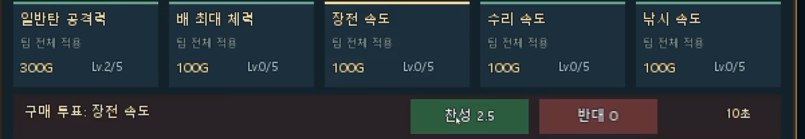
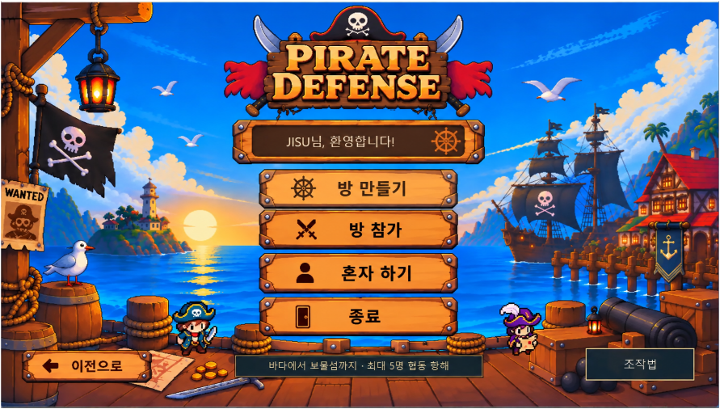
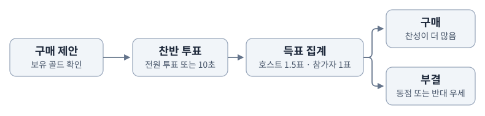
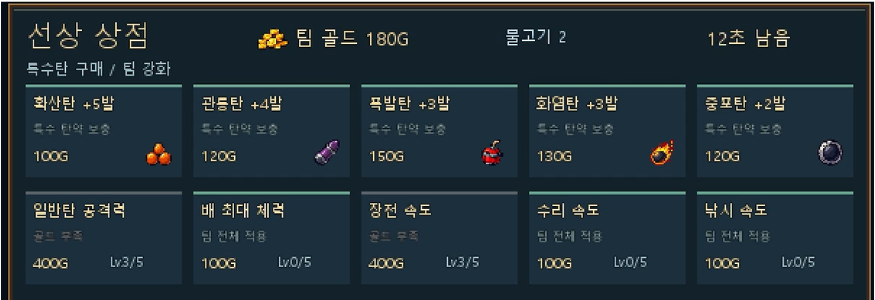

# Pirate Defense

C++과 SFML로 만든 2D 해적 디펜스 게임입니다. 5명이 함께 만든 팀 프로젝트이고, 이 저장소에는 제가 맡은 상점, 아이템, 포탄 공격 코드만 올렸습니다.


<p align="center">
  
</p>

<p align="center">멀티플레이 구매 투표 화면 (호스트 1.5표 + 참가자 1표 = 찬성 2.5)</p>

## 프로젝트 소개

- 기간: 2026.09.14 ~ 2026.09.17
- 인원: 5명
- 역할: 부팀장

적과 보스의 공격에서 배를 지키는 게임입니다. 대포를 장전해 쏘고, 배를 수리하고 불을 끄면서 버티고, 모은 골드로 상점에서 특수 포탄과 강화 아이템을 삽니다.
혼자 하거나 TCP로 같이 할 수 있고, 멀티플레이에서는 호스트가 게임 상태를 계산해 참가자에게 보냅니다.

<p align="center">
  
</p>

## 맡은 부분

### 상점과 구매 투표

- 특수탄 5종, 강화 5종을 팀 골드로 삽니다. 골드를 확인해서 차감하고, 강화는 5단계까지만 됩니다.
- 멀티플레이에서는 한 명이 구매를 제안하면 10초 동안 찬반 투표를 합니다. 호스트는 1.5표, 참가자는 1표이고 찬성이 많을 때만 삽니다. 동점이면 부결입니다.
- 투표마다 번호를 붙여서 지난 투표의 응답이 섞이지 않게 했고, 모두 투표하거나 10초가 지나면 바로 결과를 냅니다.



<p align="center">
  
</p>

### 포탄 종류별 효과

| 포탄 | 효과 |
|---|---|
| 확산탄 | 각도를 나눠 5발 발사 |
| 관통탄 | 적을 뚫고 지나감, 같은 적에게는 한 번만 피해 |
| 폭발탄 | 맞은 곳 주변에 범위 피해 |
| 화염탄 | 일정 시간 지속 피해 |
| 중포탄 | 한 발 피해가 큼 |

## 문제 해결

### 포탄별 적중 대상 관리와 중복 피해 방지
- **문제**: 관통탄이 적과 겹쳐 지나가는 동안 매 프레임 피해가 들어가고, 폭발탄은 직접 맞은 적에게 범위 피해까지 겹쳐 들어감
- **해결**: 포탄마다 맞힌 적의 ID를 저장해 이미 맞힌 적은 충돌 처리에서 제외. 폭발탄은 직접 맞은 적을 범위 피해 계산에서 빼서 주변 적에게만 폭발 피해 적용. 고친 뒤 관통탄 피해가 한 번만 들어가는 것을 확인

### 공동 골드 사용 결정
- **문제**: 팀이 골드를 같이 쓰는데 한 명이 바로 사 버리면 다른 팀원 의견이 반영되지 않음
- **해결**: 구매 제안 후 투표로 결정. 제안한 사람도 직접 찬반을 고르고, 동점이면 부결

## 파일 구성

```
src/Items/
├── CannonballType.h          # 포탄 종류
├── ShopItemType.h            # 상점 아이템 종류
├── AmmoManager.cpp / .h      # 포탄 보유 수량
├── GoldManager.cpp / .h      # 골드 확인, 차감
├── ShopManager.cpp / .h      # 구매 처리
└── UpgradeManager.cpp / .h   # 강화 단계별 수치
excerpt/
└── shop_vote_cannon.hpp      # 구매 투표, 대포 발사, 포탄 충돌
```

구매 투표와 포탄 충돌은 팀원들과 같이 쓰던 `Game.hpp` 안에 있어서, 제가 짠 부분만 `excerpt/shop_vote_cannon.hpp`로 옮겨 왔습니다. 이것만으로는 빌드되지 않습니다.

사용 기술: C++, SFML 3.1

<!-- 시연 영상 링크 넣을 곳 -->
